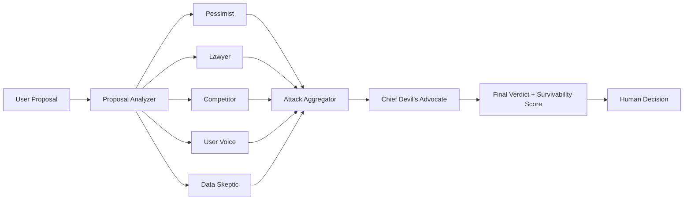

# Devil's Advocate Agents

A multi-agent critique engine that pressure-tests a proposal, idea, or business concept by simulating five different adversarial personas. The system evaluates the strengths and weaknesses of a proposal, ranks objections by severity, and produces a final verdict that summarizes whether the idea is likely to hold up under scrutiny.

## Overview

This project is designed to behave like a brutal internal review board. Instead of simply generating a summary, it asks five independent critics to attack the proposal from distinct angles:

- Pessimist: looks for failure modes, disruption risk, and worst-case scenarios
- Lawyer: focuses on legal, contractual, regulatory, and compliance risks
- Competitor: looks for market threats, strategic blind spots, and competitive weaknesses
- User Voice: evaluates whether the idea makes sense for real users and customer pain points
- Data Skeptic: questions assumptions, evidence, measurement, and decision quality

Once each critic produces an attack report, a chief devil's advocate agent consolidates the findings and emits a final verdict with:

- ranked attacks by severity
- top 3 killer blows
- counter-conditions required for survival
- a survivability score from 0 to 100
- a one-sentence final verdict

This is useful for:

- startup idea validation
- strategy review
- product decision pressure-testing
- proposal critique before execution
- investor-readiness checklists

## Features

- Multi-agent adversarial review with five critique personas
- Severity-based ranking of objections and risks
- Final verdict synthesis with survivability scoring
- Structured counter-condition generation for proposal survival
- Rich terminal output for quick human review
- Modular graph-based orchestration for easy extension
- Works well for product, strategy, and startup idea evaluation
- Designed for fast experimentation without a heavy web stack

## Demo

Below is a representative command-line flow from the project:

```text
$ python main.py

Welcome to Devil's Advocate Agent
Powered by Claude + Qdrant

Submit any idea, plan, or proposal — 5 AI critics will attack it.

Enter your proposal (or 'quit' to exit):
> We should replace our support team with a fully autonomous AI agent.

⚔️ Unleashing 5 critics...

[🔴 Pessimist] Severity: 8/10
• The model may hallucinate critical customer issues.
• Human trust will collapse if the bot misroutes urgent support cases.

[⚖️ Lawyer] Severity: 7/10
• Liability exposure increases without a clear escalation path.

[🏴‍☠️ Competitor] Severity: 9/10
• A stronger incumbent already solves this workflow at lower cost.

[👤 User Voice] Severity: 6/10
• Customers want faster answers, not a black-box automation layer.

[📊 Data Skeptic] Severity: 9/10
• No baseline proof or measurable impact data exists.

final verdict: The idea may be viable only after a controlled pilot, real customer validation, and strict fallback guarantees.
```

## Why this project exists

Many decision systems focus on optimism and forward momentum. This project takes the opposite approach: it is intentionally adversarial. It simulates the kind of criticism a founder, team lead, or product manager would want to hear before building something expensive or risky.

The goal is not to say “no” automatically. The goal is to surface hidden assumptions, risk factors, and critical conditions that must be true for the proposal to actually survive in the real world.

## Architecture

The project uses a small graph-based workflow to orchestrate the critique flow.

### High-level flow

1. The user enters a proposal or idea
2. The proposal is analyzed and summarized
3. Five persona agents attack the idea independently
4. Their attack reports are collected in a shared state object
5. A final synthesis step ranks the criticisms and produces the verdict

### Current structure

- `main.py` — terminal-based interactive interface
- `agents/` — persona logic and synthesis logic
- `graph/debate_graph.py` — LangGraph graph definition and execution flow
- `agents/state.py` — shared state schema
- `memory/` — storage for critique-related state or recall

### Graph behavior

The workflow is built from a `StateGraph` that executes the following stages:

- `init`
- `analyze`
- persona nodes (`pessimist`, `lawyer`, `competitor`, `user_voice`, `data_skeptic`)
- `verdict`
- `END`

This creates a structured pipeline where all persona critiques converge into a final score and recommendation.

### Architecture diagram



## Tech stack

- Python
- LangChain
- LangGraph
- Anthropic Claude via `langchain-anthropic`
- Rich for terminal UI rendering
- python-dotenv for environment management

## Prerequisites

Before running the app, make sure you have:

- Python 3.10 or newer
- An Anthropic API key
- Access to a terminal or command prompt

## Setup

### 1) Clone the repository

```bash
git clone https://github.com/SomaSathwik/Devils-Advocate-Agents.git
cd Devils-Advocate-Agents
```

### 2) Create a virtual environment

On Windows:

```bash
python -m venv venv
.\venv\Scripts\activate
```

On macOS/Linux:

```bash
python -m venv venv
source venv/bin/activate
```

### 3) Install dependencies

```bash
pip install rich python-dotenv langchain langchain-anthropic
```

If you use a project requirements file later, the same dependencies can be pinned there as part of a formal environment setup.

### 4) Configure environment variables

Create a `.env` file in the project root:

```bash
ANTHROPIC_API_KEY=your_api_key_here
```

This project loads environment variables with `python-dotenv`.

## Running the app

From the project root:

```bash
python main.py
```

You will be prompted to enter a proposal. Example inputs include:

```text
We should launch a lightweight AI support bot for internal teams.
```

```text
We should replace our customer support team's manual workflow with a fully automated AI triage system.
```

```text
We should build a subscription-based AI co-pilot for small businesses without a pilot program first.
```

## Output format

The program prints the critique results in a rich terminal panel layout, including:

- each persona's objection list
- severity score
- final killer blow
- overall survivability score
- top counter-conditions that must hold for the proposal to survive

The final verdict is generated through the chief advocate synthesis step, which reads the aggregated attack reports and produces a single decision summary.

## Example interpretation

A typical output may look like this conceptually:

- Lawyer: legal exposure and contract ambiguity
- Pessimist: execution risk and timeline mismatch
- Competitor: market position is weak relative to incumbents
- User Voice: unclear customer benefit and retention story
- Data Skeptic: no validation metrics or measurable baseline

The final verdict might say the proposal survives only if there is strong user demand, measurable proof, and a clear compliance strategy.

## Extending the project

This repo is a good foundation for extending the critique engine with:

- more persona types
- argument summarization and clustering
- persistent memory across proposals
- scoring weights per persona
- JSON export of critique sessions
- web UI or API wrapper
- comparison between multiple proposal variants

### Possible additions

- `api.py` for a FastAPI or Flask backend
- `tests/` for persona or graph validation
- `requirements.txt` for reproducible installs
- `logging` and structured output capture
- SQL or vector memory layer for long-term critique recall

## Security and environment notes

This project intentionally uses a local `.env` file for API keys. Avoid committing secrets or API credentials to the repository.

The `.gitignore` is configured to ignore common local environment files such as:

- `.env`
- `.venv/`
- `venv/`
- `.vscode/`
- Python cache folders

## Project status

This repository is a working prototype for adversarial proposal analysis. It is designed to be used interactively from the terminal, but it can be expanded into a more robust product or service layer.

## Roadmap

The project is intentionally modular, so it can evolve in a few clear directions:

### Phase 1: MVP refinement

- improve critique consistency across personas
- add better structured prompts for higher-quality attack outputs
- add stronger scoring and ranking logic
- reduce hallucinated or weak criticisms by improving evaluation constraints

### Phase 2: Productization

- add a web UI or dashboard for inputting proposals and viewing results
- expose the critique engine via a REST API
- add report generation for teams and executive reviews
- add proposal history and saved sessions

### Phase 3: Memory and learning

- persist user proposals and prior verdicts
- add long-term memory for repeated ideas or strategic planning
- improve recall across past critiques and similarity matching
- provide recommendation patterns derived from historical decisions

### Phase 4: Decision intelligence

- compare multiple proposals side-by-side
- include weighted scoring by team context, risk appetite, and market conditions
- add investment, product, or operational fit scoring
- support scenario analysis for multiple strategic bets

## License

This project is licensed under the MIT License. See [LICENSE](LICENSE) for the full terms.

## Contributing

Contributions are welcome if they improve:

- critique quality
- persona diversity
- output clarity
- architecture or scalability
- terminal UX

You can open an issue or submit a pull request with improvements.
